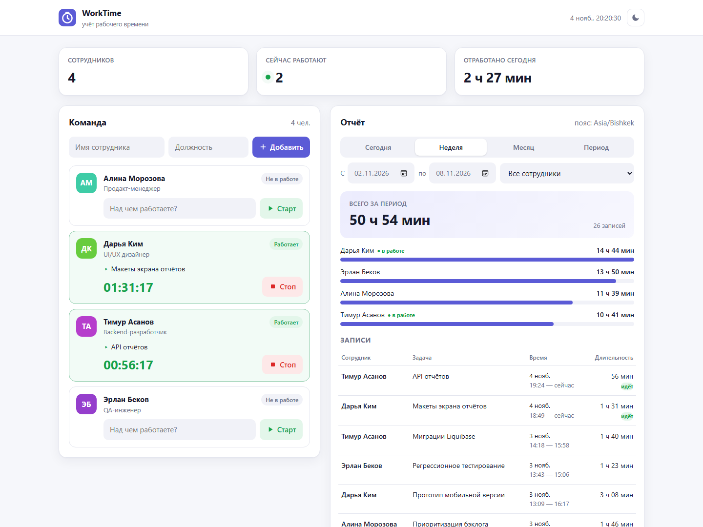
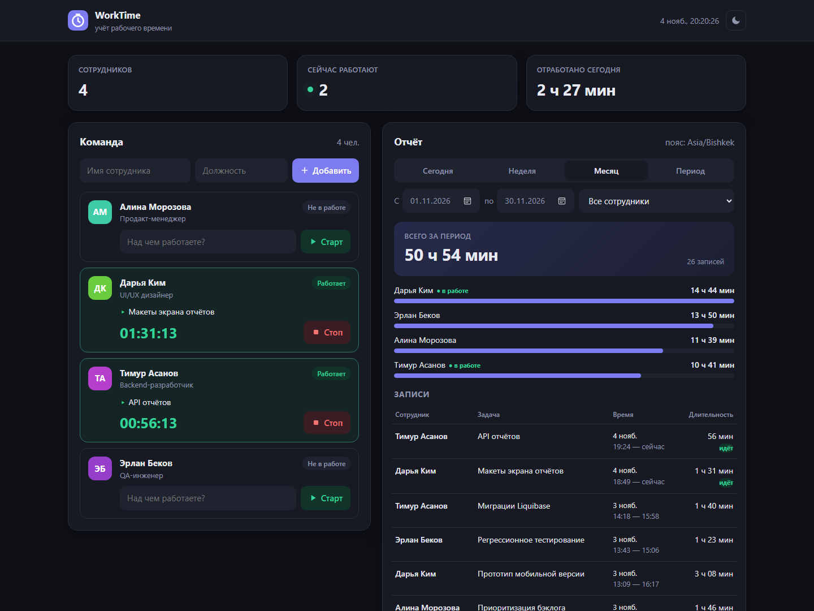
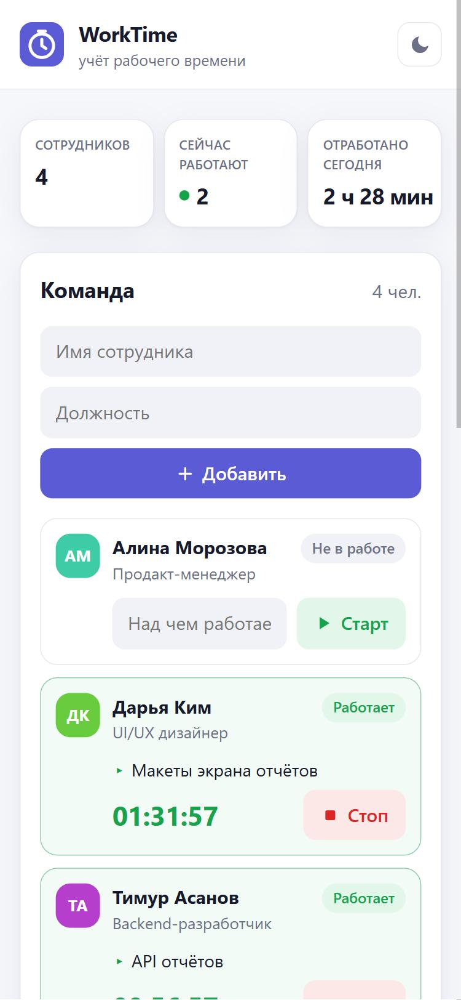
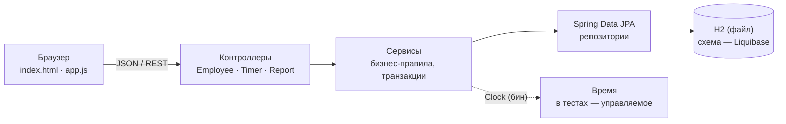
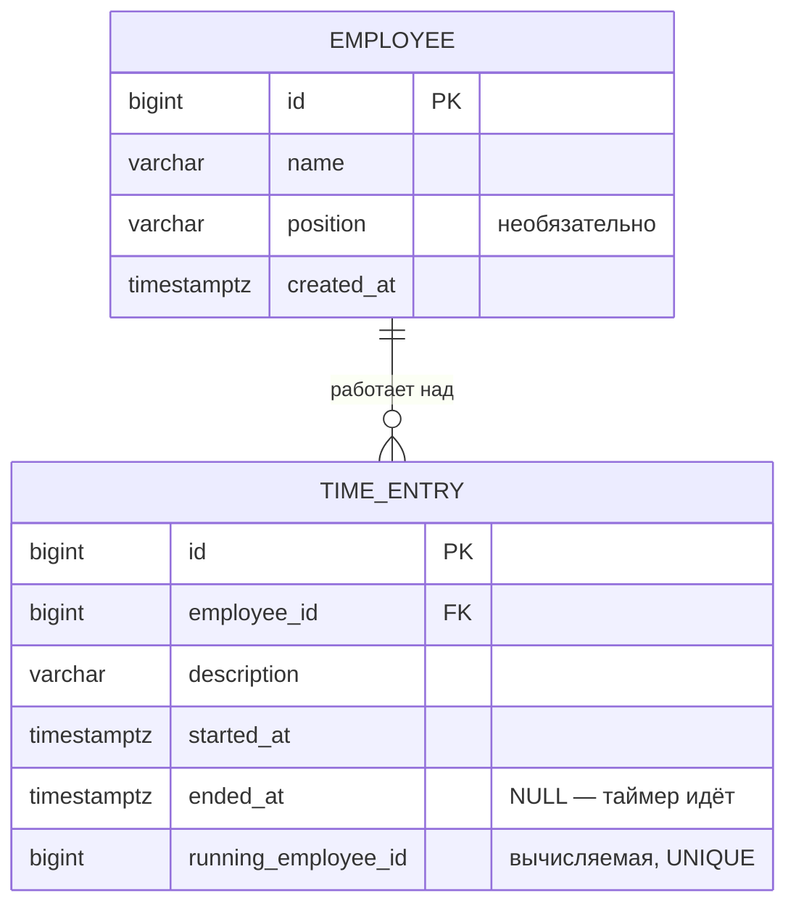

<div align="center">

# WorkTime

**Веб-приложение для учёта рабочего времени сотрудников**

Добавляйте сотрудников, запускайте таймер с описанием задачи и смотрите, сколько каждый отработал за любой период.

### [Демо: worktime.onoy.app](https://worktime.onoy.app)
<sub>Открытый стенд с вымышленными данными — можно смело нажимать любые кнопки.</sub>


-1E6FBA)




</div>

---

## Содержание

- [Что умеет](#что-умеет)
- [Быстрый старт](#быстрый-старт)
- [Как пользоваться](#как-пользоваться)
- [Архитектура](#архитектура)
- [REST API](#rest-api)
- [Проверки (тесты)](#проверки-тесты)
- [Как я работал с ИИ](#как-я-работал-с-ии)
- [Найденные и исправленные ошибки](#найденные-и-исправленные-ошибки)
- [Ограничения и что дальше](#ограничения-и-что-дальше)

Подробное техническое задание и план реализации — в [docs/TZ.md](docs/TZ.md).

---

## Что умеет

| Требование из задания | Как реализовано |
|---|---|
| Добавление сотрудников | Форма «Имя + должность», валидация на клиенте и на сервере |
| Запуск и остановка таймера с описанием задачи | Кнопки «Старт/Стоп» в карточке сотрудника, живой счётчик `ЧЧ:ММ:СС` |
| Записи и общее время каждого сотрудника за период | Пресеты «Сегодня / Неделя / Месяц» и произвольный период, фильтр по сотруднику, итоги с полосами |
| Сохранение данных после перезапуска | Файловая БД H2 в `./data`, схема через Liquibase; проверено отдельным тестом с настоящим перезапуском |
| Проверки основных сценариев | 37 автотестов, включая **повторный запуск таймера** и **пустой отчёт** |

Сверх задания:

- **Один таймер на сотрудника — гарантия на уровне БД.** Повторный старт возвращает `409` и не сбрасывает идущий таймер. Даже если два запроса придут одновременно, проходит ровно один: строка сотрудника блокируется, а в БД стоит уникальный индекс.
- **Записи через полночь** честно делятся между днями: в отчёт попадает только часть, которая пересекается с периодом.
- **Часовые пояса.** Отчёт строится в поясе браузера, поэтому «сегодня» везде означает сегодня.
- **Идущие таймеры видны сразу:** счётчики, итоги и полосы обновляются каждую секунду без запросов к серверу.
- Адаптивная вёрстка, светлая и тёмная темы, понятные сообщения об ошибках на русском.
- Профиль `demo` создаёт вымышленных сотрудников и двухнедельную историю, чтобы сразу было что посмотреть.

<details>
<summary>Тёмная тема и мобильная версия</summary>
<br>

<br><br>

</details>

---

## Быстрый старт

Нужна только **JDK 21**. Maven ставить не надо: в репозитории есть Maven Wrapper.

```bash
git clone <ссылка-на-репозиторий> worktime
cd worktime

# Linux / macOS
./mvnw spring-boot:run

# Windows
mvnw.cmd spring-boot:run
```

Откройте **http://localhost:8080**. Данные сохраняются в `./data/worktime.mv.db`.

**С демо-данными** (вымышленные сотрудники и история за две недели; срабатывает только на пустой БД):

```bash
./mvnw spring-boot:run -Dspring-boot.run.profiles=demo
```

**Готовый jar:**

```bash
./mvnw package
java -jar target/worktime.jar
```

**Docker:**

```bash
docker build -t worktime .
docker run -p 8080:8080 -v worktime-data:/data worktime
```

**Тесты:**

```bash
./mvnw test
```

### Как развёрнуто демо

VPS на Ubuntu 24.04. Приложение работает как systemd-сервис под отдельным пользователем без прав, в песочнице, где писать можно только в каталог с БД. HTTPS обеспечивает Caddy: он сам получает и продлевает сертификат Let's Encrypt. Конфиги лежат в [`deploy/`](deploy):

- [`worktime.service`](deploy/worktime.service) — systemd-юнит;
- [`Caddyfile.snippet`](deploy/Caddyfile.snippet) — блок reverse proxy для поддомена.

Обновление стенда: `./mvnw package`, скопировать `target/worktime.jar` на сервер и выполнить `systemctl restart onoy-worktime`.

### Настройки

| Переменная окружения | По умолчанию | Назначение |
|---|---|---|
| `PORT` | `8080` | HTTP-порт |
| `DB_URL` | `jdbc:h2:file:./data/worktime` | Где хранить БД |
| `APP_TIME_ZONE` | `Asia/Bishkek` | Пояс отчёта, если браузер не передал свой |

---

## Как пользоваться

1. **Добавьте сотрудника** в блоке «Команда»: имя обязательно, должность — по желанию.
2. **Запустите таймер:** опишите задачу («Вёрстка лендинга») и нажмите «Старт» или Enter. Карточка станет зелёной, пойдёт счётчик.
3. **Остановите таймер** кнопкой «Стоп». Запись сохранится, а длительность появится во всплывающем уведомлении.
4. **Смотрите отчёт** справа: выберите период, при необходимости отфильтруйте по сотруднику. Сверху показан общий итог, ниже — время каждого и список записей.

---

## Архитектура

Классический монолит Spring Boot. Фронтенд — статические файлы (HTML + CSS + чистый JS, без сборки), которые раздаёт тот же сервер.



```
src/main/java/dev/worktime
├── employee/   сотрудники: сущность, репозиторий, сервис, контроллер, DTO
├── timer/      записи времени и таймер: старт/стоп, правило «один таймер»
├── report/     отчёты: период, обрезка по границам, итоги
├── common/     исключения и единый формат ошибок (RFC 9457 Problem Details)
└── config/     настройки, Clock, демо-данные
src/main/resources
├── db/changelog/   миграции Liquibase
└── static/         фронтенд
```

### Модель данных



Отдельной таблицы «таймеров» нет. Идущий таймер — это запись с `ended_at = NULL`. Так у данных один источник правды и не нужно ничего синхронизировать.

### Ключевые решения

| Решение | Почему |
|---|---|
| **Инвариант «один идущий таймер» в БД.** Вычисляемая колонка `running_employee_id = CASE WHEN ended_at IS NULL THEN employee_id END` с уникальным индексом | Проверка только в коде пропускает гонку двух одновременных запросов. Уникальный индекс допускает сколько угодно `NULL` (остановленных записей), но только одно значение `employee_id` (идущий таймер) |
| **`SELECT … FOR UPDATE` по сотруднику** при старте и стопе | Запросы одного сотрудника выполняются строго по очереди, и пользователь получает понятный `409`, а не ошибку констрейнта |
| **Повторный старт → `409`, а не автостоп** | Молча закрыть чужую запись хуже, чем явно сообщить, что таймер уже идёт. Текущий таймер не трогается |
| **Время хранится в UTC (`Instant`), период — даты + пояс** | «С 1 по 7 ноября» превращается в полуинтервал `[1 ноября 00:00, 8 ноября 00:00)` в нужном поясе. Записи на границе дней не теряются и не считаются дважды |
| **`Clock` как бин** | Сервисы не вызывают `Instant.now()`. Тесты двигают время вперёд мгновенно, без `sleep` |
| **Liquibase + `ddl-auto: validate`** | Схемой управляют версионируемые миграции. Hibernate только сверяет маппинг и не меняет таблицы молча |
| **H2 в файловом режиме** | Не нужно ставить СУБД: клонировал и запустил. Для продакшена достаточно поменять `DB_URL` и драйвер (например, на PostgreSQL с частичным уникальным индексом) |
| **Фронтенд без фреймворка** | Для одной страницы сборщик и `node_modules` были бы лишними. Весь UI — около 440 строк читаемого JS |

---

## REST API

| Метод | Путь | Описание |
|---|---|---|
| `GET` | `/api/employees` | Список сотрудников с идущими таймерами |
| `GET` | `/api/employees/{id}` | Один сотрудник |
| `POST` | `/api/employees` | Создать: `{"name": "...", "position": "..."}` → `201` |
| `POST` | `/api/employees/{id}/timer/start` | Запустить: `{"description": "..."}` → `201`; уже идёт → `409` |
| `POST` | `/api/employees/{id}/timer/stop` | Остановить → `200`; не запущен → `409` |
| `GET` | `/api/reports/summary?from=&to=[&tz=]` | Итоги по каждому сотруднику за период |
| `GET` | `/api/reports/entries?from=&to=[&employeeId=][&tz=]` | Записи за период, новые сверху |

<details>
<summary>Примеры запросов и ответов</summary>

```bash
curl -X POST localhost:8080/api/employees \
     -H "Content-Type: application/json" \
     -d '{"name":"Анна Иванова","position":"Дизайнер"}'

curl -X POST localhost:8080/api/employees/1/timer/start \
     -H "Content-Type: application/json" \
     -d '{"description":"Макеты главной страницы"}'

curl -X POST localhost:8080/api/employees/1/timer/stop

curl "localhost:8080/api/reports/summary?from=2026-11-01&to=2026-11-07&tz=Europe/Moscow"
```

```json
{
  "from": "2026-11-01",
  "to": "2026-11-07",
  "timeZone": "Europe/Moscow",
  "totalSeconds": 5400,
  "entryCount": 2,
  "empty": false,
  "employees": [
    { "employeeId": 1, "name": "Анна Иванова", "position": "Дизайнер",
      "totalSeconds": 5400, "entryCount": 2, "running": false }
  ]
}
```

Ошибки приходят в едином формате [RFC 9457](https://www.rfc-editor.org/rfc/rfc9457):

```json
{
  "status": 409,
  "title": "Conflict",
  "detail": "Таймер для «Анна Иванова» уже запущен (задача «Макеты главной страницы»). Сначала остановите его."
}
```

Пустой период — это не ошибка: ответ `200` с `"empty": true`, а у каждого сотрудника стоит `0`.
</details>

---

## Проверки (тесты)

**37 тестов**, `./mvnw test`, около 30 секунд. API-тесты поднимают приложение целиком (контроллеры → сервисы → Liquibase → H2 в памяти) и работают с управляемыми часами.

| Сценарий | Где |
|---|---|
| **Повторный запуск таймера** → `409`, первый таймер не сброшен, запись одна | `TimerApiTest.secondStartIsRejected` |
| **Пустой отчёт**: нет ни сотрудников, ни записей → `200`, нули | `ReportApiTest.emptyReportWithoutEmployees` |
| **Пустой отчёт**: сотрудники есть, записей в периоде нет → у каждого `0` | `ReportApiTest.emptyReportWithEmployees` |
| Старт → стоп через 90 мин → ровно 5400 с | `TimerApiTest.startAndStop` |
| Стоп без таймера, двойной стоп → `409` | `TimerApiTest.stopWithoutRunningTimer` |
| После стопа можно стартовать снова | `TimerApiTest.restartAfterStop` |
| Таймеры разных сотрудников независимы | `TimerApiTest.independentTimers` |
| Пустое описание, пустое или длинное имя, битый JSON → `400` | `TimerApiTest`, `EmployeeApiTest` |
| Итоги по сотрудникам, сортировка, фильтр записей | `ReportApiTest.totalsPerEmployee` |
| Запись через полночь делится между днями | `ReportApiTest.entryAcrossMidnightIsClipped` |
| Идущий таймер считается до «сейчас» и не попадает в будущий период | `ReportApiTest.runningTimer*` |
| Параметр `tz` сдвигает границы дней | `ReportApiTest.timeZoneParameter` |
| Некорректный период, дата, пояс, сотрудник → `400` / `404` | `ReportApiTest.invalidParameters` |
| **8 одновременных стартов → ровно один таймер** | `ConcurrencyTest.parallelStartsCreateExactlyOneTimer` |
| Уникальный индекс в БД срабатывает даже в обход сервиса | `ConcurrencyTest.databaseRejectsSecondRunningTimer` |
| **Данные и идущий таймер переживают настоящий перезапуск** приложения | `PersistenceAfterRestartTest` |
| Пересечение интервалов: 8 граничных случаев | `TimeMathTest` |
| Перевод дат периода в моменты времени | `PeriodTest` |
| Демо-данные создаются на пустой БД | `DemoDataSeederTest` |

Кроме автотестов, я вручную прошёл UI в браузере на ширине десктопа и телефона, в светлой и тёмной темах. Так нашлись три ошибки вёрстки (см. ниже).

---

## Как я работал с ИИ

### Инструменты и модели

| Инструмент | Модель | Роль в проекте |
|---|---|---|
| **Claude Code** (десктопное приложение, вкладка Code) | **Claude Opus 5.5** (`claude-opus-5-5`) | Совместное планирование (разбор задания, ТЗ, варианты решений), затем реализация: код, тесты, сборка, проверка UI во встроенном браузере, развёртывание по SSH, документация |

### Подход: планируем вместе, реализует агент

С ИИ я работал как с напарником-разработчиком. План мы составляли вместе: я задавал рамки и критерии качества, ИИ разбирал задание и предлагал варианты, а я выбирал и утверждал решения. Реализацию и рутинные проверки выполнял агент, и каждый результат я принимал только после проверки.


Агентный режим выбран потому, что ИИ не только пишет код, но и сам его **запускает**: собирает проект, гоняет тесты, поднимает сервер, кликает по интерфейсу, читает логи. Поэтому большинство ошибок из [таблицы ниже](#найденные-и-исправленные-ошибки) нашлось на этапе проверки, а не попало в результат.

### Ключевые запросы и решения

Запросы приведены в отредактированном виде: часть исходно была надиктована голосом.

#### 1. Совместное планирование: ТЗ до кода

> **Запрос:** «Давай сначала вместе разберём задание и составим ТЗ: требования, стек, модель данных, план работ. Стек — Java, дополнительные технологии только там, где они оправданы. По каждому решению — обоснование и альтернативы. Код пишем, когда план согласован.»

- **Как планировали:** ИИ разобрал страницу вакансии и выписал требования R1–R9 и критерии оценки. Дальше мы по шагам прошли стек (со сравнением альтернатив), модель данных, правила для таймера и отчёта и план тестов. Итог — [docs/TZ.md](docs/TZ.md). По ходу работы план уточнялся (см. пункт 2).
- **Зачем так:** ТЗ до начала кода фиксирует требования и критерии приёмки, и результат проверяется по чек-листу, а не «на глаз» ([docs/TZ.md, §11](docs/TZ.md#11-критерии-приёмки)). Обоснование каждого решения делает их прозрачными для ревью: в README есть таблица [«Ключевые решения»](#ключевые-решения), а в ТЗ — сравнение стека с альтернативами.

#### 2. Миграции: Liquibase вместо Flyway

> **Запрос:** «Миграции делаем на Liquibase, а не на Flyway.»

- **Почему это правильно здесь:** changelog Liquibase описывает изменения декларативно и не привязан к одной СУБД. Переход с H2 на PostgreSQL не потребует переписывать миграции. Кроме того, Liquibase умеет откатывать изменения и проверять условия перед их применением (preconditions), и это стандарт в энтерпрайз-проектах на Java.
- **Результат:** схема описана в трёх changeset'ах, Hibernate работает в режиме `validate`. Ограничение «один идущий таймер» записано в миграции `003` как уникальный индекс.

#### 3. Ручная проверка нашла дыру в UX

> **Запрос:** «При проверке страница постоянно показывает „Failed to fetch“ — разберись, в чём причина.»

- **Что выяснилось:** сервер был остановлен, а открытая страница продолжала его опрашивать. Ошибки, которую вернул сам сервер, и обрыва связи приложение не различало.
- **Результат:** отдельное состояние «нет связи»: одна понятная плашка вместо потока ошибок и автоматическое переподключение. Это [ошибка №7](#найденные-и-исправленные-ошибки): автотесты её не ловили, а ручная проверка поймала.

#### 4. Публичное демо на собственной инфраструктуре

> **Запрос:** «Выложим приложение на наш сервер под поддоменом onoy.app, чтобы проверяющий мог открыть демо по ссылке.»

- **Зачем:** проверяющему не нужно клонировать проект и ставить JDK, чтобы посмотреть результат.
- **Как сделано:** стенд встроен в уже работающую на VPS инфраструктуру и не мешает соседним сервисам:
  - systemd-сервис под отдельным пользователем без прав, в песочнице;
  - порт открыт только для Docker-сети, через которую работает Caddy;
  - HTTPS через существующий Caddy;
  - перед правкой его конфига сделан бэкап, а применён конфиг только после проверки командой `caddy validate`.

<details>
<summary>Что агент делал самостоятельно, без отдельных запросов</summary>
<br>

- Сверился с Maven Central и выбрал стабильную ветку Spring Boot 4.0, а не 3.5, у которой подходит к концу бесплатная поддержка.
- Проверил по содержимому jar, а не по памяти, в каком пакете в Spring Boot 4 лежит `@AutoConfigureMockMvc`: в 4.x тестовые автоконфигурации разнесены по модулям.
- Открывал приложение на ширине 375px и сверял вычисленные стили через `getComputedStyle`.

</details>

### Как я проверял результат

| Принцип | Как применялся |
|---|---|
| **Требование = тест** | Каждый пункт задания закрыт конкретным тестом ([таблица выше](#проверки-тесты)). «Данные сохраняются» проверяется настоящим перезапуском приложения, а не моком |
| **Думать о гонках** | Проверка «таймер уже идёт» только в коде не спасает от двух одновременных запросов, поэтому добавлены блокировка строки, уникальный индекс и тест на 8 параллельных потоков |
| **Руками, а не только тестами** | UI пройден на десктопе и телефоне, в светлой и тёмной теме. Так нашлись ошибки №2–5 и №7–9 |
| **Отличать баг от окружения** | Ошибка кодировки в `curl` оказалась особенностью Windows, а не приложения ([№10](#найденные-и-исправленные-ошибки)) |

---

## Найденные и исправленные ошибки

Всё ниже — реальные ошибки из этой сессии разработки, а не придуманные для README.

| # | Что было не так | Как нашли | Причина и исправление |
|---|---|---|---|
| 1 | **Тест «данные переживают перезапуск» писал в настоящую БД проекта**, а не во временную папку. Первый прогон прошёл случайно | При втором прогоне `mvn test` тест упал: `["Анна", "Анна", "Пётр", "Пётр"]` вместо двух сотрудников | `SpringApplicationBuilder.properties(...)` задаёт свойства **по умолчанию** с самым низким приоритетом, и `application.yml` их перекрывал. URL БД теперь передаётся аргументом командной строки, а тест дополнительно проверяет, что файл БД появился именно во временной папке. Мусорная `./data` удалена |
| 2 | **На телефоне мобильные стили не применялись:** цифры 28px вместо 18px, «2 ч 28 мин» вылезало из карточки | Скриншот на 375px, затем `getComputedStyle`: media query срабатывает, а `font-size` всё равно 28px | Блок `@media` стоял в CSS **раньше** базовых правил с той же специфичностью, и побеждали более поздние. Перенёс мобильный блок в конец файла |
| 3 | **Карточка сотрудника шире панели на телефоне**: обрезались статус и кнопка «Старт» | Визуальная проверка на 375px | Grid-колонка внутри карточки растягивалась по min-content поля ввода. Исправлено через `grid-template-columns: minmax(0, 1fr)` и `width: 0; flex: 1` у поля |
| 4 | **Таблица записей вылезала из панели** на средней ширине: колонка «Длительность» обрезалась, появлялся горизонтальный скролл | Визуальная проверка на ширине около 800px | Время записи разбито на две строки (день и интервал), а на телефоне строки таблицы превращаются в карточки |
| 5 | **Полосы в отчёте «застывали»**: секунды у идущих таймеров тикали, а ширина полос нет | Наблюдение за живым отчётом | Ширина полос считалась один раз при загрузке. Теперь пересчитывается каждую секунду вместе со значениями |
| 6 | **Живой таймер зависел от часов компьютера пользователя**: при сбитых часах показывал неверное время | Ревью кода фронтенда | Время старта приходит с сервера, а «сейчас» берётся из браузера. Добавлена поправка на расхождение по заголовку `Date` ответа сервера |
| 7 | **При остановленном сервере страница сыпала одинаковыми тостами «Failed to fetch»** — непонятно и на английском | Я заметил при ручной проверке: страница была открыта, а сервер остановлен | Сетевая ошибка (запрос не дошёл до сервера) теперь отделена от ошибки, которую вернул сервер. Вместо тостов показывается одна плашка «Нет связи с сервером», страница каждые 5 секунд пробует переподключиться и сама убирает плашку |
| 8 | **Список записей рос бесконечно**: за месяц в отчёте выводились все записи подряд (в демо их больше сотни), страница становилась огромной | Я заметил при проверке отчёта за месяц | Добавлена пагинация: по 10 записей на страницу, номера страниц с «…» (`1 … 5 6 7 … 13`), счётчик «51–60 из 124». При смене периода или сотрудника список возвращается на первую страницу |
| 9 | **После добавления пагинации страница перестала загружаться**: пустые даты периода, ни одного сотрудника | Проверка в браузере сразу после правки, в консоли `SyntaxError: Identifier 'total' has already been declared` | В функции отрисовки отчёта уже была переменная `total`, и новая с тем же именем ломала весь скрипт. Переменная переименована, синтаксис дополнительно проверяется через `node --check` |
| 10 | **Ложная тревога:** `curl` с кириллицей в теле запроса получал `400 «Тело запроса должно быть корректным JSON»` | Ручной прогон API из Git Bash на Windows | Приложение ни при чём: под Windows `curl` перекодировал аргументы не в UTF-8. С телом из UTF-8 файла (`--data-binary @body.json`) всё работает. Это подтверждают и тесты MockMvc с кириллицей |

---

## Ограничения и что дальше

Осознанно **не** делал, потому что задание говорит «авторизация и сложные роли не нужны»:

- авторизацию и роли: сейчас любой пользователь управляет любым таймером;
- редактирование и удаление записей и сотрудников;
- экспорт отчёта.

Что бы я сделал следующим шагом:

1. Правку записей задним числом (забыл остановить таймер) с журналом изменений.
2. Экспорт отчёта в CSV или Excel.
3. PostgreSQL вместо H2 для многопользовательской работы: инвариант переносится один к одному через частичный уникальный индекс `WHERE ended_at IS NULL`.
4. Автоостановку «забытых» таймеров по расписанию, например через 12 часов.

---

<div align="center">
<sub>Все имена и данные в проекте вымышленные.</sub>
</div>
